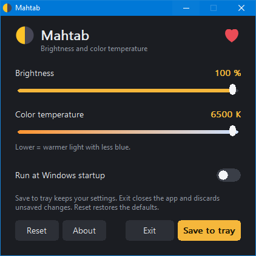

# Mahtab

Small, dependency-free screen brightness and color temperature control for Windows (tray app).




**Author:** Milad Ramzany
**License:** GPLv3

---

## Support

If you find this software useful, please consider starring the project ⭐ and making a donation.

**Bitcoin (BTC):**

```
bc1qkhlk39ce9zkqakkl6cvzxnaccl6phjqm09fvs7
```

Thank you ❤️

---

## Build

Install [w64devkit](https://github.com/skeeto/w64devkit), open its shell in this folder, and run:

```sh
sh build.sh
```

---

## Optional: adaptive brightness CLI

`src/cli_main.cpp` and `src/win_capture.cpp` are an optional console prototype of adaptive (screen-content based) brightness. They are **not** part of the app. To build them:

```sh
sh build-adaptive-cli.sh
```

---

## Tests

Any OS with `g++`:

```sh
g++ -std=c++17 tests/test_core.cpp src/core.cpp -o t1 && ./t1

g++ -std=c++17 -I tests/stubs -I src tests/engine_test.cpp tests/engine_stubs.cpp src/engine.cpp src/core.cpp -o t2 && ./t2
```
